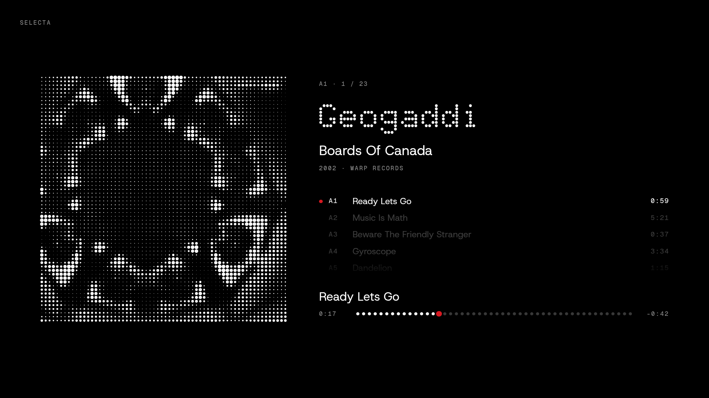
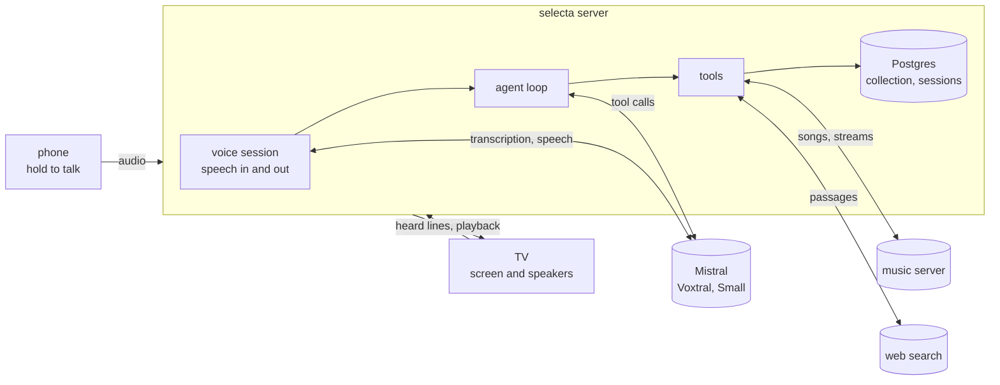

<p align="center">
  
</p>

<p align="center">
  <a href="https://github.com/felipemagr/selecta/actions/workflows/ci.yml"></a>
  <a href="LICENSE"></a>
  
</p>

<p align="center">
  A voice agent that asks what you feel like hearing, picks a record from <b>your own</b>
  collection, and plays it on your TV.
</p>

<p align="center">
  
</p>

## What it is

You hold a button on your phone and talk. Selecta asks a few short questions (mood, energy, how
long you have, who's with you), picks a record you own that fits, and plays it on the TV, where
the whole conversation shows up word by word as it speaks. It only ever picks from your shelf: a
selector for one collection, not a streaming recommender.

<table>
  <tr>
    <td></td>
    <td></td>
    <td rowspan="2" width="22%"></td>
  </tr>
  <tr>
    <td align="center">a question over the record, while it thinks</td>
    <td align="center">the answer, word by word as it's said</td>
  </tr>
</table>

These are screenshots of real sessions with my own collection. The phone remote's screenshot is from the
browser.

## Features

- **A spoken interview** in English, Spanish or French. Answers are saved with your own words as
  evidence, `UNKNOWN` when you can't say, and validated in code. Say "just pick something" and it
  stops asking.
- **Picks you can trust.** Code chooses the candidates (mood, energy, length, what's playable,
  what you turned down), the model chooses among them and says why. It never announces a pick or
  a playing record that didn't happen.
- **Plays it.** Tracks stream from your music server to the TV; skip, or start from any track.
- **Knows your records.** Tracklists, credits and notes from Discogs, search by meaning, and web
  lookups for a record's story that always name their source.
- **Remembers.** What you picked or turned down in the last 30 days shapes what it offers next.
- **Interruptible.** Press the button while it talks and it stops; the history keeps only what
  you actually heard.
- **Traceable.** Every turn stores the context the model saw, its tool calls, the state before
  and after, latency and tokens. Each session ends with a JSON summary.

## Requirements

- [Docker](https://docs.docker.com/get-docker/) with Compose.
- A [Mistral API key](https://console.mistral.ai) (the agent, speech and indexing).
- Optional: a [Discogs](https://www.discogs.com) collection, a Subsonic-compatible music
  server such as [Navidrome](https://www.navidrome.org), and an Android TV.

## Quickstart

With the sample collection, so no Discogs or music server is needed:

```bash
git clone https://github.com/felipemagr/selecta && cd selecta
cp .env.example .env            # set MISTRAL_API_KEY and POSTGRES_PASSWORD
docker compose up -d --build
docker compose exec app selecta index --from /examples/collection.json
```

Open <http://localhost:8000/tv> in one tab (the screen) and <http://localhost:8000> in another
(the remote), hold the button and talk. Without a music server, Selecta picks a record but
doesn't play it.

Prefer the terminal? `docker compose exec app selecta chat` runs the same agent as a text chat.

## How I run it

My setup, as one example of a full install:

- **Collection:** my records on [Discogs](https://www.discogs.com), exported nightly with
  `selecta sync`.
- **Music:** the downloaded albums in [Navidrome](https://www.navidrome.org). Selecta matches each
  record's tracks to the server's songs, so it knows what it can play and what's vinyl only.
- **Server:** a small homelab running NixOS, with Selecta and its database as two containers
  (the image is published to `ghcr.io/felipemagr/selecta`).
- **HTTPS:** [Tailscale](https://tailscale.com) serves the app inside my private network; the
  phone's microphone needs HTTPS.
- **TV:** an Android TV with the Selecta app from
  [Releases](https://github.com/felipemagr/selecta/releases). It's a thin full-screen shell for
  the `/tv` page that allows sound without a tap.
- **Phone:** the remote page added to the home screen.

### Your own collection

1. Create a Discogs personal access token at <https://www.discogs.com/settings/developers> and
   set `DISCOGS_TOKEN` in `.env`.
2. `make sync`: exports the collection to `data/discogs/` and indexes it. Each record gets a mood
   and energy from one model call, and its facts and artist profiles are embedded for search.
   Both are cached by a hash of their input, so a resync only pays for what changed.

### Your own music server

Selecta talks to the music server through the [Subsonic API](https://www.subsonic.org/pages/api.jsp),
so any Subsonic-compatible server should work (Navidrome is the one I use and test with; Gonic or
Airsonic should too). Set `NAVIDROME_URL`, `NAVIDROME_USER` and `NAVIDROME_PASSWORD`, and use a
non-admin user. Jellyfin or Plex would need a small adapter: see
[CONTRIBUTING](CONTRIBUTING.md#adding-a-music-server).

## How it works



- **One hand-written loop.** Each turn the model gets a short persona and the interview state
  (what's been answered, what to ask next, the candidates) and replies with text, tool calls or
  both. Tools change the session; the loop rebuilds the state and calls the model again, up to
  four rounds.
- **Code decides, the model talks.** The interview order, validation, candidate choice and
  playback checks are plain Python in `domain/` and `application/`. The model extracts answers,
  chooses among candidates and talks.
- **Streaming voice.** Speech is transcribed after you let go of the button, the reply streams
  from the model sentence by sentence, and each sentence is spoken as soon as it's complete.
- **Three layers.** `domain/` (types and rules, no I/O), `application/` (the agent, its tools,
  ports), `infrastructure/` (Mistral, Postgres, the music server, the web server). Imports only
  point inward, enforced by import-linter.

## Configuration

Everything is set by environment variables, usually in `.env` (see
[`.env.example`](.env.example)).

| variable | |
|---|---|
| `MISTRAL_API_KEY` | required: the agent, transcription, speech and indexing |
| `POSTGRES_PASSWORD`, `DATABASE_URL` | required: the database |
| `DISCOGS_TOKEN` | your Discogs collection |
| `NAVIDROME_URL`, `NAVIDROME_USER`, `NAVIDROME_PASSWORD` | a Subsonic music server, to play records |
| `TAVILY_API_KEY`, `COHERE_API_KEY` | web lookups about records |
| `SELECTA_AGENT_MODEL` | the agent's model (default `mistral-small-2603`) |
| `SELECTA_HOST`, `SELECTA_PORT` | where the server listens (default `127.0.0.1:8000`) |
| `SELECTA_DATA_DIR` | where exports and caches go (default `data/`) |

## Evals

`make test` runs the unit tests: free and offline. `make eval` runs the agent against the real
model on the sample collection, so it costs a little (well under a dollar a run). It plays 17
situations (the interview, a hurried listener, picking, playing, a failed player, a vinyl-only
record, skipping tracks, turning a record down, questions about a record, a record you don't own,
switching language), each said two ways in three languages, five times each, and reports
**pass^5**: a case counts only if it passed every time. On every run it also checks that the
agent never claims a record is playing when it isn't, never uses a record that doesn't exist, and
answers in your language. `make eval ARGS="--simulate"` adds whole conversations with simulated
listeners (cooperative, vague, hurried, picky, curious, switching language).

## Development

```bash
make install    # uv sync
make test       # lint, format check, import layers, then pytest
make quality    # fix lint and format
make db         # the local database, for the database tests
```

See [CONTRIBUTING](CONTRIBUTING.md).

## License

[Apache 2.0](LICENSE).
